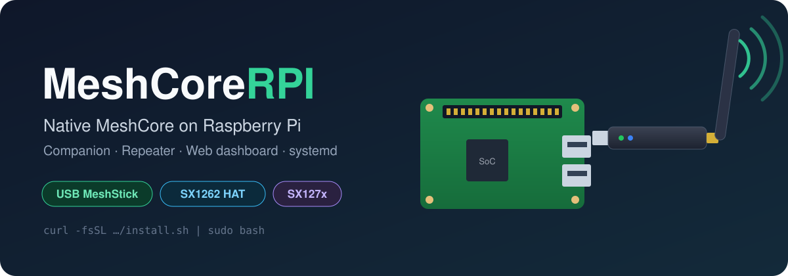

<p align="center">
  
</p>

<p align="center">
  <a href="https://github.com/engperini/MeshCoreRPI/releases/latest"></a>
  
  
  <a href="license.txt"></a>
  <a href="https://github.com/engperini/MeshCoreRPI/stargazers"></a>
</p>

# MeshCoreRPI

Run **[MeshCore](https://github.com/meshcore-dev/MeshCore) natively on a Raspberry Pi**: as a **Companion**
(talk to the mesh from a web dashboard, RemoteTerm or meshcore-cli over your LAN) or as a **Repeater**,
with a LoRa HAT on the GPIO header **or just a USB LoRa stick**. No microcontroller, no flashing:
a Debian package, a systemd service and one config file.

> [!WARNING]
> Use at your own risk. You are responsible for your hardware and for transmitting only on
> frequencies and power levels that are legal where you are.

## Highlights

- 🔌 **USB MeshStick support (new).** Plug a CH341 + SX1262 USB LoRa stick (e.g. the Elecrow
  MeshStick, `lsusb` → `1a86:5512`) into any USB port. Pins, TCXO and RF switch are preset.
- 📡 **LoRa HATs:** SX1262 (e.g. Waveshare) and SX127x modules on the SPI header.
- 💬 **Companion:** MeshCore companion protocol over TCP (port 5000) plus an optional BLE bridge.
- 🔁 **Repeater:** full MeshCore repeater with CLI over TCP.
- 🖥️ **Web dashboard:** built-in companion/repeater web UI (ports 8080/8081).
- ⚙️ **Easy to run:** one-line installer, `.deb` packages, systemd services, config in `/etc/raspberrypimc/*.env`
  that is never overwritten on upgrade.
- 🩺 **Honest diagnostics:** startup prints the effective config and a `radio-diag` JSON, and checks that
  the radio answers (the USB stick refuses to start without it; HATs log a warning).

## Supported hardware

| Radio | How it connects | `RPI_RADIO_DRIVER` | Status |
|---|---|---|---|
| USB MeshStick (CH341A + SX1262) | USB | `sx1262_ch341` | ✅ Tested: RX, TX, DMs, channels |
| SX1262 HAT (e.g. Waveshare) | SPI + GPIO | `sx1262` (default) | ✅ Tested |
| SX127x module | SPI + GPIO | `sx127x` | ⚠️ Supported, less tested |

Raspberry Pi with **64-bit Raspberry Pi OS** (Bookworm or newer). One radio runs one role: Companion **or**
Repeater (two roles on one HAT is possible with [spi-bridge](https://github.com/dabeani/RPI_spi-bridge)).

## Quick start (USB MeshStick)

1. **Attach the antenna first**, then plug the stick into the Pi.
2. Install and start the companion:

   ```bash
   curl -fsSL https://raw.githubusercontent.com/engperini/MeshCoreRPI/main/install.sh | sudo bash
   ```

   The installer downloads the latest release, installs it with apt, detects the MeshStick,
   selects its driver and starts `raspberrypimc-companion.service`.
   For a repeater instead: `... | sudo bash -s -- repeater`.
3. Check that the radio answers:

   ```bash
   sudo journalctl -u raspberrypimc-companion -b | grep -E "radio-diag|fatal"
   ```

   You want `"driver":"sx1262_ch341"` and a `status` other than `0`/`255`.
4. Connect a client (below), **set your region's radio parameters**, send an advert, and say hi. 👋

Using a HAT? Install the same way, then set `RPI_RADIO_DRIVER` and the pins in
`/etc/raspberrypimc/companion.env` (see [Advanced reference](#advanced-reference)).

## Connect a client

| Client | How |
|---|---|
| Built-in web dashboard | `http://<pi-ip>:8080` (companion) / `:8081` (repeater) |
| [RemoteTerm](https://github.com/jkingsman/Remote-Terminal-for-MeshCore) | TCP connection to `<pi-ip>:5000` |
| [meshcore-cli](https://pypi.org/project/meshcore-cli/) | `meshcore-cli -t <pi-ip> -p 5000` |
| MeshCore phone app over BLE | enable the BLE bridge: `RPI_COMPANION_BLE_ENABLE=1` (experimental) |

The companion port is unauthenticated: keep it on your LAN, never expose it to the Internet.
If another app already uses port 8080, set `RPI_COMPANION_WEB_PORT` (or `RPI_COMPANION_WEB_ENABLE=0`).

## Radio settings by region

All nodes must use **exactly** the same frequency, bandwidth, spreading factor and coding rate.
Set them in your client (they are saved on the Pi) and confirm with your local community.

| Region | Frequency | Bandwidth | SF | CR | Notes |
|---|---|---|---|---|---|
| 🇧🇷 Brazil (MeshCore Brasil) | 923.125 MHz | 62.5 kHz | 8 | 8 | preset "Australia: SA, WA, Brazil"; path hash 2 bytes |
| 🇪🇺 EU/UK (narrow) | 869.618 MHz | 62.5 kHz | 8 | 8 | |

To force them from the config file instead (applied at every start, and shown in the apps):

```dotenv
RPI_FREQ_HZ=923125000
RPI_BW_HZ=62500
RPI_SF=8
RPI_CR=8
RPI_TX_DBM=20
```

## Everyday commands

```bash
sudo nano /etc/raspberrypimc/companion.env           # edit config
sudo systemctl restart raspberrypimc-companion       # apply it
sudo journalctl -u raspberrypimc-companion -f        # live log: every RX/TX with RSSI/SNR
```

Range testing? Let the companion advertise itself every N minutes:
`RPI_ADVERT_INTERVAL_MIN=15` (and `RPI_ADVERT_MODE=zerohop` for direct neighbours only). Turn it off afterwards.

## Troubleshooting

| Symptom | Fix |
|---|---|
| `SX1262 not responding (GetStatus=0xFF)` | Wrong driver/pins, or the stick is not plugged in. For the MeshStick use `RPI_RADIO_DRIVER=sx1262_ch341`. |
| `CH341 claim interface 0 failed: LIBUSB_ERROR_BUSY` | Another program has the stick (e.g. `meshtasticd`, or a second MeshCoreRPI). Stop it. |
| `libusb-1.0 not found` | `sudo apt install libusb-1.0-0` |
| Adverts arrive but direct messages are not acknowledged | The other node does not know you yet: send a flood advert from the Pi first. |
| App shows other radio params than the log's `radio-diag` | Update to the latest release (fixed: params set from the app are now applied to the chip). |

## Build from source

```bash
sudo apt install -y git python3-venv build-essential libusb-1.0-0
git clone https://github.com/engperini/MeshCoreRPI && cd MeshCoreRPI
python3 -m venv ~/pio-venv && ~/pio-venv/bin/pip install platformio
~/pio-venv/bin/pio run -e RaspberryPiMC_native_companion   # or RaspberryPiMC_native_repeater
sudo apt install ./RaspberryPiMC/dist/raspberrypimc-native-companion_*.deb
```

Each build also produces the `.deb` in `RaspberryPiMC/dist/`.

## Guia rápido (PT-BR)

1. Conecte a antena e depois o MeshStick no Pi.
2. `curl -fsSL https://raw.githubusercontent.com/engperini/MeshCoreRPI/main/install.sh | sudo bash`
3. Abra `http://<ip-do-pi>:8080`, ou conecte o RemoteTerm em `<ip-do-pi>:5000`.
4. Configure a rede MeshCore Brasil: **923.125 MHz, BW 62.5 kHz, SF 8, CR 8**, path hash 2 bytes.
5. Mande um advert (flood) e teste com outro nó.

## Credits

- [MeshCore](https://github.com/meshcore-dev/MeshCore) by Scott Powell / rippleradios.com: the mesh firmware this runs.
- [dabeani/MeshCoreRPI](https://github.com/dabeani/MeshCoreRPI) by Bernhard Marker: the original native Raspberry Pi
  port this fork builds on. Support the original author: [buymeacoffee.com/bmks](https://buymeacoffee.com/bmks).
- CH341 USB access follows the approach of [libpinedio-usb](https://github.com/pine64/libpinedio-usb) and
  Meshtastic's MeshStick support.

MIT licensed, see [license.txt](license.txt).

---

## Advanced reference

### About this port

This fork (based on MeshCore `v1.13`/`v1.14`) builds MeshCore for Linux and runs it on the Pi.
It was first tested with this LoRa HAT: https://www.amazon.de/dp/B0C61XFGHC

- By default one radio runs `Repeater` **or** `Companion`.
- With [spi-bridge](https://github.com/dabeani/RPI_spi-bridge) (multiple virtual SPI devices on one hardware SPI)
  you can run `Repeater` **and** `Companion` on the same Pi.
- Reference radio settings: [pyMC_Repeater radio-settings.json](https://github.com/rightup/pyMC_Repeater/blob/3e47122daee85734d323009d67f606257828698f/radio-settings.json)

### Runtime configuration options (`/etc/raspberrypimc/*.env`)

Core radio/runtime keys:

```dotenv
RPI_FREQ_HZ=869618000
RPI_SF=8
RPI_BW_HZ=62500
RPI_CR=8
RPI_TX_DBM=22

# Radio backend selector
RPI_RADIO_DRIVER=sx1262   # or: sx127x, sx1262_ch341 (USB MeshStick)

# SPI device node prefix (default: /dev/spidev)
RPI_SPI_DEV_PREFIX=/dev/spidev

RPI_SPI_BUS=0
RPI_SPI_CS=0
RPI_SPI_SPEED_HZ=1000000
RPI_CS_PIN=21
RPI_RESET_PIN=18
RPI_BUSY_PIN=20
RPI_IRQ_PIN=16
RPI_TXEN_PIN=13
RPI_RXEN_PIN=12

RPI_USE_TCXO=0
RPI_USE_DIO2_RF=0
```

Notes:

- If `RPI_RADIO_DRIVER` is unset, default is `sx1262`.
- If `RPI_SPI_DEV_PREFIX` is unset, default is `/dev/spidev`.
- Repeater/Companion binaries now read role config files directly on startup:
	- repeater: `/etc/raspberrypimc/repeater.env`
	- companion: `/etc/raspberrypimc/companion.env`
- Optional override for both binaries: `RPI_CONFIG_FILE=/path/to/custom.env`.
- Role config file values are applied as effective runtime values at startup.
- After changing env values, restart the service:

```bash
sudo systemctl restart raspberrypimc-repeater.service
sudo systemctl restart raspberrypimc-companion.service
```

### Startup diagnostics (config verification)

On startup, both native binaries print:

- `startup-config: ...` (interpreted effective values)
- `radio-diag: {...}` (current radio diagnostic JSON)

Use these lines to verify values such as `RPI_SPI_DEV_PREFIX`, pins, speed, and radio driver immediately after start.

### Package config-file behavior

Package install/upgrade does **not** overwrite existing files:

- `/etc/raspberrypimc/repeater.env`
- `/etc/raspberrypimc/companion.env`

Defaults are shipped as examples:

- `/usr/share/raspberrypimc/repeater.env.example`
- `/usr/share/raspberrypimc/companion.env.example`

If a role env file is missing, package post-install creates it from the matching example.

### Build-time limits/debug options (PlatformIO)

These are compile-time options (rebuild required after changes):

- `MAX_CONTACTS`
- `MAX_GROUP_CHANNELS`
- `MESH_DEBUG`
- `MESH_PACKET_LOGGING`

For RaspberryPiMC native targets, set them in `platformio.ini` under:

- `[env:RaspberryPiMC_native_repeater]`
- `[env:RaspberryPiMC_native_companion]`

### USB MeshStick (CH341 + SX1262) profile

USB LoRa dongles built on a CH341A bridge (`lsusb` shows `1a86:5512`), such as the
Elecrow MeshStick, are driven over USB with libusb instead of the Pi GPIO/SPI header:

```dotenv
RPI_RADIO_DRIVER=sx1262_ch341   # alias: meshstick
```

- Pins are CH341 D-lines. MeshStick defaults are applied automatically: CS=D0, RESET=D2,
  BUSY=D4, IRQ=D6. Leftover BCM pin numbers in the env file are ignored.
- `RPI_USE_TCXO` and `RPI_USE_DIO2_RF` default to `1` for this driver.
- `RPI_SPI_*` settings are not used.
- Needs `libusb-1.0-0` (`sudo apt-get install -y libusb-1.0-0`), root (the services already run as root),
  and no other program (e.g. `meshtasticd`) holding the dongle.
- Startup fails with `SX1262 not responding (GetStatus=0x..)` if the radio does not answer,
  instead of running with fake radio statistics.

Expected in `radio-diag`: `"driver":"sx1262_ch341"` and a `status` other than 0 or 255
(in RX mode it is typically 0x5X, i.e. 80..95).

### Companion periodic advert (minutes)

The companion app's periodic advert setting is in hours. For range tests the native
companion can advertise itself on its own schedule:

```dotenv
RPI_ADVERT_INTERVAL_MIN=15    # 0 (default) = off
RPI_ADVERT_MODE=flood         # or zerohop (direct neighbours only, less airtime)
```

Each advert costs airtime on a shared channel; turn it back off (or raise it) after testing.

### SX127x quick-start profile

If you use an SX127x-based module, set the driver explicitly and adjust GPIO pins to your wiring:

```dotenv
RPI_RADIO_DRIVER=sx127x
RPI_SPI_DEV_PREFIX=/dev/spidev
RPI_SPI_BUS=0
RPI_SPI_CS=0
RPI_SPI_SPEED_HZ=1000000

# Example GPIO mapping (change for your board/wiring)
RPI_CS_PIN=21
RPI_RESET_PIN=18
RPI_IRQ_PIN=16
RPI_TXEN_PIN=-1
RPI_RXEN_PIN=-1
```

Then restart the service and verify from CLI:

```text
radio-diag
```

Expected: `"driver":"sx127x"` in the diagnostic JSON.

### 1) Binary install prerequisites

```bash
sudo apt-get update
sudo apt-get install -y libgpiod-dev gpiod jq curl
```

### 2) Binary install (repeater)

```bash
sudo dpkg -i raspberrypimc-native-repeater_*.deb
sudo nano /etc/raspberrypimc/repeater.env
sudo systemctl enable --now raspberrypimc-repeater.service
systemctl is-enabled raspberrypimc-repeater.service
systemctl status raspberrypimc-repeater.service --no-pager
```

### 3) Build on Raspberry Pi (advanced)

```bash
sudo apt-get update
sudo apt-get install -y python3 python3-pip python3-venv python3-dev libgpiod-dev gpiod jq curl
```

Build target should be Linux `aarch64` (best: build directly on the Pi).

```bash
cd ~/MeshCoreRPI
sudo apt update
sudo apt install -y python3-venv python3-full

python3 -m venv .venv
. .venv/bin/activate
python -m pip install --upgrade pip
pip install platformio

platformio run -e RaspberryPiMC_native_repeater
platformio run -e RaspberryPiMC_native_companion
```

### 4) Repeater autostart flow

```bash
cd ~/MeshCoreRPI
git pull
rm -rf ~/MeshCoreRPI/RaspberryPiMC/dist/*
bash RaspberryPiMC/build_deb.sh repeater
sudo dpkg -i RaspberryPiMC/dist/raspberrypimc-native-repeater_*.deb
sudo nano /etc/raspberrypimc/repeater.env
sudo systemctl enable --now raspberrypimc-repeater.service
```

Verify persistence after reboot:

```bash
systemctl is-enabled raspberrypimc-repeater.service
systemctl status raspberrypimc-repeater.service --no-pager
```

After env changes:

```bash
sudo systemctl restart raspberrypimc-repeater.service
```

### 5) Companion service flow

```bash
cd ~/MeshCoreRPI
git pull
bash RaspberryPiMC/build_deb.sh companion
sudo dpkg -i RaspberryPiMC/dist/raspberrypimc-native-companion_*.deb
sudo systemctl restart raspberrypimc-companion.service
systemctl status raspberrypimc-companion.service --no-pager
```

### 6) Companion debug run (manual)

```bash
/usr/lib/raspberrypimc/companion/program \
	--freq 869618000 --sf 8 --bw 62500 --cr 8 --tx 22 \
	--radio-driver sx1262 \
	--spi-dev-prefix /dev/spidev \
	--spi-bus 0 --spi-cs 0 --cs-pin 21 --spi-speed 1000000 \
	--reset-pin 18 --busy-pin 20 --irq-pin 16 --txen-pin 13 --rxen-pin 12 \
	--no-tcxo --no-dio2-rf
```

Feel Free to Download / Modify / Distribute
